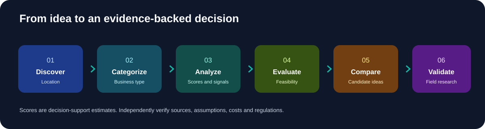
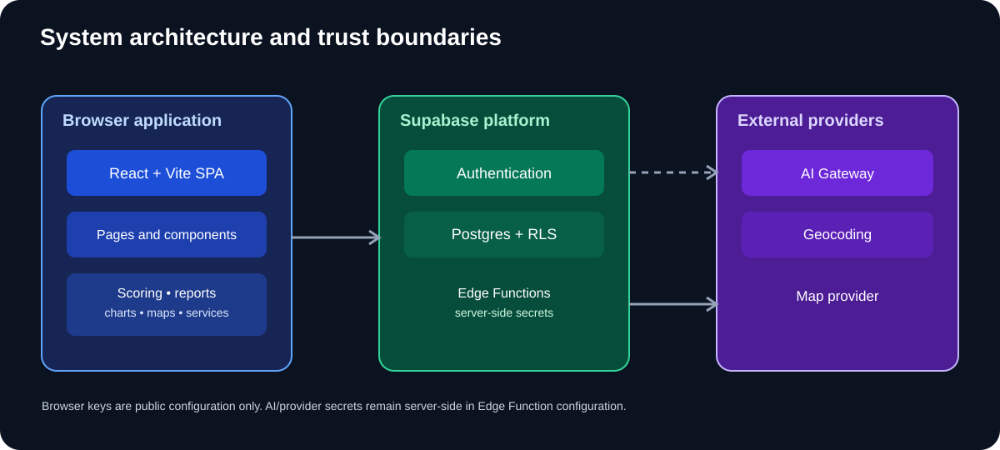
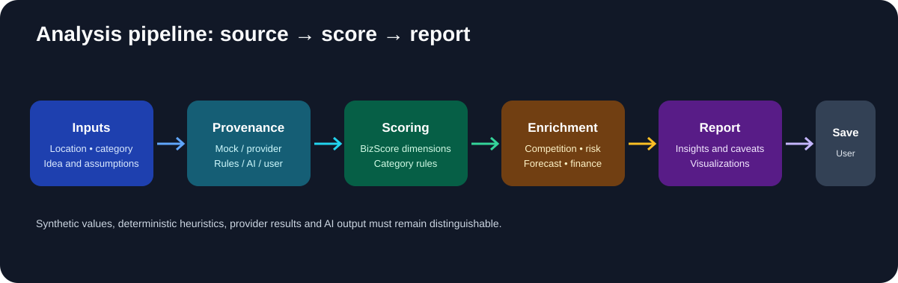
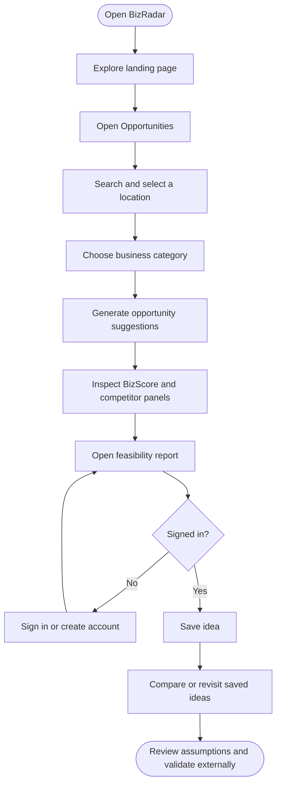

<div align="center">

# 🧭 BizRadar Insights

### Discover, compare, and evaluate business opportunities with location-aware market intelligence.

[](https://react.dev/)
[](https://www.typescriptlang.org/)
[](https://vite.dev/)
[](https://supabase.com/)
[](https://tailwindcss.com/)
[](LICENSE)
[](https://github.com/Brajesh31/bizradar-insights/issues)
[](https://github.com/Brajesh31/bizradar-insights/stargazers)
[](https://github.com/Brajesh31/bizradar-insights/commits/main)
[](https://github.com/Brajesh31/bizradar-insights)

</div>

> [!IMPORTANT]
> **Decision-support prototype, not a source of verified market truth or financial advice.** Several analytics engines currently use mock, rule-based, or randomized inputs. AI edge functions use an external model gateway, while some local analysis is deterministic/template-based. Always independently validate market counts, rent, financial projections, regulations, and competitor information before investing.

---

## 🌟 What is BizRadar Insights?

BizRadar Insights is a React and TypeScript web application for exploring business opportunities by location and category. It combines a business opportunity discovery workflow with feasibility reports, BizScore calculations, competitor analysis, market/category intelligence, forecast panels, map visualizations, saved ideas, comparison tools, and AI-assisted analysis.

The repository contains a Vite single-page application, Supabase authentication and persistence integration, Supabase Edge Functions, SQL migrations, reusable UI components, and client-side analytics engines.

### 🎯 Product goals

- Help an entrepreneur turn a broad business idea into a structured hypothesis.
- Compare candidate locations and business categories.
- Make scoring dimensions and risk factors easier to inspect.
- Keep selected ideas available for later review.
- Present assumptions and limitations alongside recommendations.
- Build a foundation for evidence-backed local-market research.

## ✨ Feature map

| Area | Capabilities evidenced in the repository |
|---|---|
| 🗺️ Location discovery | Location search, coordinates, map view, map/heatmap utilities |
| 💡 Opportunity exploration | Category-based opportunity suggestions and cards |
| 📊 BizScore | Demand, competition, location, and economic score dimensions |
| 🧭 Feasibility reporting | Summary, SWOT, financial estimates, risks, recommendation |
| 🥊 Competitor intelligence | Competitor scanning, proximity, density and quality panels |
| 📈 Forecasting | Category growth projections, seasonal forecast and trend views |
| 🧠 AI-assisted analysis | Idea parsing, generated insights and authenticated assistant edge function |
| 💾 Saved ideas | Save analysis records for the signed-in user |
| ⚖️ Comparison | Compare opportunity candidates |
| 🔐 Authentication | Supabase email/password sign-up, sign-in, session persistence and sign-out |
| 🧰 UI system | Tailwind CSS, Radix UI primitives, shadcn-style components, charts and icon set |

> **Data provenance matters:** feature labels are not a guarantee that all values come from live external datasets. Review [Data sources and limitations](docs/data-sources.md) and [Analytics methodology](docs/analytics-methodology.md).

## 🖼️ Product workflow visuals

### End-to-end journey



### System architecture



### Analysis pipeline



The diagrams are explanatory assets maintained in this repository. They are not screenshots of a running deployment.

## 🔄 Main user journey



## 🧠 AI and analytics boundaries

The application uses multiple kinds of analysis. These must not be described as one undifferentiated AI system.

| Component | Implementation observed | Interpretation |
|---|---|---|
| Market data generator | Tier-based formulas and random variation | Synthetic/mock data |
| Opportunity generator | Category-specific templates and score adjustments | Rule/template-based suggestions |
| BizScore/scoring engines | Local TypeScript calculations | Deterministic scoring from supplied inputs |
| Forecast engine | Fixed category annual growth rates | Formula projection, not trained predictive model |
| Feasibility summary helper | Template-based text construction | Not an LLM call |
| Idea parsing function | Supabase Edge Function calls Lovable AI Gateway | External model-generated structured output |
| Insight generation function | Supabase Edge Function calls Lovable AI Gateway | External model-generated summary |
| AI assistant function | Authenticated Supabase user plus conversation context | External model-backed chat flow |
| Competition/geocoding integrations | Service modules and external APIs where configured | Availability and provenance depend on provider/configuration |

Scores and forecasts are heuristics. They are not audited financial estimates, verified demand measurements, or guaranteed business outcomes.

## 🧱 Technology stack

### Frontend
- React 18 and React DOM
- TypeScript
- Vite
- React Router
- Tailwind CSS
- Radix UI and shadcn-style components
- TanStack Query
- Recharts
- Mapbox GL
- React Hook Form and Zod
- Lucide React

### Backend and platform
- Supabase Auth
- Supabase Postgres
- Supabase JavaScript client
- Supabase Edge Functions using Deno
- Supabase SQL migrations
- Lovable AI Gateway for model calls

### Development tooling
- npm
- ESLint
- TypeScript compiler
- Vite build and preview
- Supabase CLI for local/platform workflows (install separately when needed)

## 🗺️ Application routes

| Route | Page component | Purpose |
|---|---|---|
| `/` | `Index` | Landing page |
| `/opportunities` | `Opportunities` | Search location/category and explore suggestions |
| `/feasibility-report` | `FeasibilityReport` | Detailed business analysis |
| `/saved` | `SavedIdeas` | User's saved analysis records |
| `/compare` | `Compare` | Compare candidate ideas |
| `/idea-analyzer` | `IdeaAnalyzer` | Parse/analyze a business idea |
| `/auth` | `Auth` | Sign-up and sign-in |
| `/about` | `About` | Product information |
| `/contact` | `Contact` | Contact page |
| Fallback | `NotFound` | Unknown routes |

Some routes require authentication for their data flow. Review the page and Supabase RLS policies before changing access behavior.

## 📂 Repository structure

```text
bizradar-insights/
├── .github/                   # Workflows, templates and automation
├── assets/
│   └── diagrams/              # Repository architecture/product SVGs
├── docs/                      # Product, technical, security and operations guides
├── public/                    # Static public assets, favicon, robots.txt
├── src/
│   ├── components/            # Product components and UI primitives
│   ├── contexts/              # Auth and application contexts
│   ├── hooks/                 # Shared React hooks
│   ├── integrations/supabase/ # Generated Supabase client/types
│   ├── lib/                   # Scoring, finance, risk, reporting engines
│   ├── pages/                 # Route-level pages
│   └── services/              # Market, map, AI, forecast and data services
├── supabase/
│   ├── functions/             # Edge Functions
│   └── migrations/            # SQL schema migrations
├── .env.example
├── package.json
├── package-lock.json
├── README.md
├── SECURITY.md
├── CONTRIBUTING.md
└── LICENSE
```

The tree above highlights principal areas. It is not intended to omit or replace the existing component library, generated files, or application source.

## ⚙️ Requirements

- Node.js compatible with the Vite 5 toolchain. Node 18+ is a practical baseline; use a currently supported LTS release in development.
- npm.
- A Supabase project for authentication, tables, and Edge Functions.
- Supabase project URL and publishable/anon browser key.
- Mapbox public token only if the map implementation requires it.
- Deno/Supabase CLI if you plan to develop and deploy Edge Functions locally.

## 🚀 Getting started

### 1. Clone the repository

```bash
git clone https://github.com/Brajesh31/bizradar-insights.git
cd bizradar-insights
```

### 2. Install dependencies

Use the committed npm lockfile:

```bash
npm ci
```

### 3. Configure local environment

Create your local environment file from the example:

```bash
cp .env.example .env
```

PowerShell:

```powershell
Copy-Item .env.example .env
```

Set the following values in your local `.env`:

| Variable | Required | Purpose |
|---|---:|---|
| `VITE_SUPABASE_URL` | Yes | Supabase project URL |
| `VITE_SUPABASE_PUBLISHABLE_KEY` | Yes | Browser-safe publishable/anon key |
| `VITE_MAPBOX_TOKEN` | Conditional | Public browser token for map rendering if required |

**Never put a Supabase service-role key, database password, Lovable AI key, or other server secret into a `VITE_*` variable.** Vite exposes `VITE_*` values in client-side bundles.

### 4. Configure Supabase

1. Create or select a Supabase project.
2. Set the URL and browser-safe publishable key in local `.env`.
3. Review `supabase/config.toml`.
4. Apply the SQL migrations in chronological order using the Supabase CLI or dashboard.
5. Configure Edge Function secrets such as `LOVABLE_API_KEY` in Supabase's server-side secret manager.
6. Review authentication redirect URLs and row-level security before enabling real users.

See [Supabase setup](docs/supabase-setup.md), [Database](docs/database.md), and [Environment configuration](docs/configuration.md).

### 5. Start the development server

```bash
npm run dev
```

Open the local URL printed by Vite.

### 6. Run validation commands

```bash
npm run lint
npm run build
npm run preview
```

`npm run preview` serves the built bundle locally. It does not deploy the app publicly.

## 🧪 Quality checks

| Command | Purpose |
|---|---|
| `npm ci` | Install exact dependency graph from lockfile |
| `npm run dev` | Start Vite development server |
| `npm run lint` | Run ESLint |
| `npm run build` | Create production bundle |
| `npm run build:dev` | Create development-mode bundle |
| `npm run preview` | Preview existing production build |

The repository's existing package scripts do not include a dedicated unit-test command. Do not interpret a successful lint or build as proof that analytics, database permissions, map APIs, or AI responses are correct.

## 🔐 Security, privacy and responsible use

- Do not commit `.env`. The repository previously contained a tracked environment file; treat its configuration values as public and remove the file from Git tracking.
- Rotate any server-side secret if it was ever committed.
- Use publishable Supabase keys only in the browser.
- Keep Lovable AI/API provider keys in Edge Function secrets.
- Audit RLS policies on every user-owned table.
- Validate Edge Function input, request size, authorization, and rate limits.
- Avoid storing unnecessary personal/business contact information.
- Do not treat model output or generated market metrics as verified facts.
- Do not provide financial guarantees or investment recommendations based only on heuristic scores.

See [SECURITY.md](SECURITY.md), [Threat model](docs/threat-model.md), and [Privacy](docs/privacy.md).

## 📚 Documentation library

| Guide | Coverage |
|---|---|
| [Documentation index](docs/README.md) | All guides, diagrams and templates |
| [Product overview](docs/overview.md) | Goals, audience, scope and workflows |
| [Requirements](docs/requirements.md) | Functional and non-functional requirements |
| [Architecture](docs/architecture.md) | Frontend, services, Supabase and Edge Functions |
| [Project structure](docs/project-structure.md) | Directory and module inventory |
| [Installation](docs/installation.md) | Clean local setup |
| [Configuration](docs/configuration.md) | Browser and server environment settings |
| [Supabase setup](docs/supabase-setup.md) | Auth, migrations, functions and RLS |
| [Database](docs/database.md) | Tables, migrations and access boundaries |
| [API and Edge Functions](docs/api.md) | Function contracts and error handling |
| [Analytics methodology](docs/analytics-methodology.md) | BizScore, scoring and forecasts |
| [Data sources](docs/data-sources.md) | Mock, rule-based and external data provenance |
| [Feature workflows](docs/workflows.md) | User journeys and process diagrams |
| [Testing](docs/testing.md) | Unit, integration, security and manual QA |
| [Accessibility](docs/accessibility.md) | WCAG-oriented web review checklist |
| [Performance](docs/performance.md) | Rendering, maps, charts and query performance |
| [Security review](docs/security-review.md) | Observed risks and remediation |
| [Threat model](docs/threat-model.md) | Assets, trust boundaries and abuse cases |
| [Privacy](docs/privacy.md) | Data minimization and retention |
| [Deployment](docs/deployment.md) | Build, hosting and Supabase deployment |
| [Operations](docs/operations.md) | Logs, monitoring, support and maintenance |
| [Backup and recovery](docs/backup-recovery.md) | Database recovery guidance |
| [Troubleshooting](docs/troubleshooting.md) | Common development and runtime failures |
| [FAQ](docs/faq.md) | Project questions |
| [Glossary](docs/glossary.md) | Terms and score vocabulary |
| [Technical debt](TECHNICAL_DEBT.md) | Prioritized engineering backlog |
| [Roadmap](ROADMAP.md) | Proposed product and engineering phases |
| [Changelog](CHANGELOG.md) | Repository history |

## 🤝 Contributing

Read [CONTRIBUTING.md](CONTRIBUTING.md). Use focused changes, retain existing application code, describe data provenance, and include test evidence. Use the issue templates under `.github/ISSUE_TEMPLATE/`.

## 📄 License

MIT. See [LICENSE](LICENSE).

---

<div align="center">

**Explore smarter. Validate assumptions. Build with evidence.** 🚀

</div>
