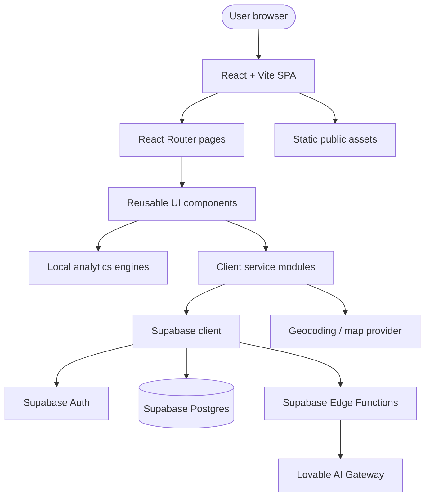

# 🏗️ System Architecture

## 1. Architectural overview

BizRadar is a Vite-hosted React single-page application with browser-side route handling, reusable React components, TypeScript calculation modules, Supabase client integration, and Supabase Edge Functions.

## 2. Frontend composition

`src/main.tsx` mounts the React application. `src/App.tsx` composes:
- TanStack Query's QueryClientProvider.
- Supabase AuthContext.
- Radix/shadcn TooltipProvider.
- Toast providers.
- BrowserRouter and route definitions.

The route tree is explicit in `src/App.tsx`. The catch-all NotFound route is declared after custom routes.

## 3. Module responsibilities

| Directory | Responsibility | Design note |
|---|---|---|
| `src/pages/` | Route-level page orchestration | Keep pages focused on state and composition |
| `src/components/` | Product-specific cards, panels, maps and navigation | Shared presentation components |
| `src/components/ui/` | Reusable primitive components | shadcn/Radix-based UI surface |
| `src/contexts/` | Cross-route application state, especially auth | Avoid duplicating session logic |
| `src/hooks/` | Shared hooks | Prefer composable, testable behavior |
| `src/lib/` | Scoring, finance, reporting, risk, comparison engines | Mostly local calculation logic |
| `src/services/` | External integrations and data-generation services | Verify provider provenance and failures |
| `src/integrations/supabase/` | Supabase client and generated DB types | Types should match migrations |
| `supabase/functions/` | Server-side function endpoints | Secrets belong in function environment only |
| `supabase/migrations/` | Database schema changes | Apply in chronological order |

## 4. Authentication and session

`AuthContext` listens for Supabase auth state changes, checks an existing session, and exposes sign-up, sign-in, sign-out, loading, user and session values. The context is mounted above routes in `App.tsx`.

The client uses a browser-safe Supabase URL and publishable key. Authorization must still be enforced by database RLS and Edge Function JWT checks; a frontend route guard is not a security boundary.

## 5. Data and computation

The application has two broad execution paths:
1. Browser-local calculation: input values are passed through functions in `src/lib/` and `src/services/`.
2. Remote calls: Supabase Auth, Postgres table operations, Edge Functions, model gateway and configured geocoding/map services.

Not all data is fetched from external market datasets. Some local generators use templates, static category assumptions, and randomness. Keep the source type visible in any report.

## 6. Edge Function architecture

The checked-in functions include:
- `parse-idea`: parses free-text ideas into structured business metadata.
- `generate-insights`: requests a short opportunity insight.
- `ai-assistant`: authenticated conversational assistant with user-scoped history.

The Supabase configuration sets JWT verification false for `parse-idea` and true for `ai-assistant` and `generate-insights`. The unauthenticated endpoint therefore requires strict input validation, quotas, and abuse controls.

## 7. Architectural constraints

- Business calculation and UI components are closely coupled in some page flows.
- Some services generate synthetic/mock data.
- Edge Functions use permissive CORS origin `*` in the inspected source.
- Edge Function input validation and rate limiting need a consistent standard.
- There is no dedicated test script in the current package manifest.
- Type definitions are generated and must stay aligned with SQL migrations.
- The checked-in `.env` should not remain tracked.

## 8. Recommended direction

Keep the SPA, but formalize boundaries: schema-validated input/output contracts, typed service modules, versioned data-source metadata, reusable calculation tests, RLS policy tests, rate-limited Edge Functions, and a visible separation between synthetic and externally sourced data.
