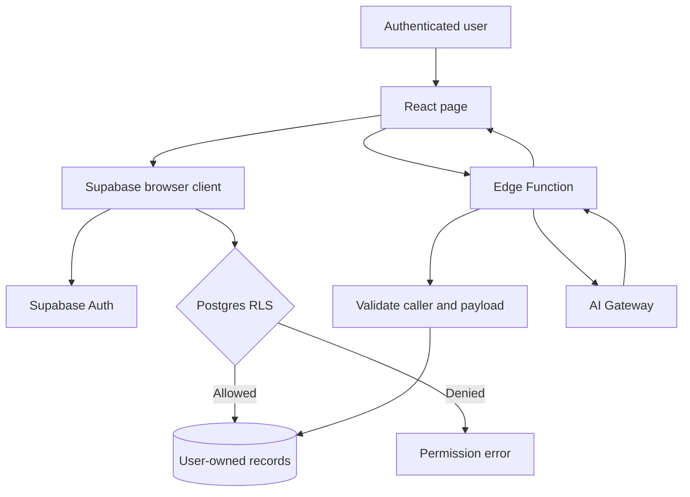

# 🗄️ Database and Data Model

## Schema source of truth

SQL migration history lives in `supabase/migrations/`. Generated/maintained TypeScript database types live in `src/integrations/supabase/types.ts`. Migrations are the authority for schema changes; this document is a conceptual map only.

## Domain concepts

The application persists or references:
- Authenticated users.
- Saved business ideas.
- Custom ideas and analysis results.
- AI assistant conversations and message history.
- Structured report and opportunity attributes.

For exact table names, fields, constraints and policies, inspect each committed migration and the generated database types. Do not create columns based on UI assumptions.

## Data flow

## Authorization expectations

- Client-supplied `user_id` is not proof of ownership.
- Insert policies bind the row owner to `auth.uid()`.
- Select/update/delete policies restrict records to their owner.
- Edge Functions validate caller identity before touching private data.
- Service-role credentials never reach browser code.

## Migration workflow

1. Create a new timestamped SQL migration.
2. Add constraints, indexes and RLS policies with schema changes.
3. Apply against a disposable project.
4. Test fresh install and upgrade from previous migration state.
5. Regenerate TypeScript types.
6. Run two-user RLS checks.
7. Update API, privacy and architecture docs.
8. Document rollback implications.

## Schema review

- [ ] Explicit primary and foreign keys.
- [ ] Suitable indexes for filters and joins.
- [ ] Correct NOT NULL/default/check constraints.
- [ ] RLS enabled for user-owned tables.
- [ ] Intentional select/insert/update/delete policies.
- [ ] JSON payload boundaries validated in application/functions.
- [ ] Unnecessary personal fields excluded.
- [ ] Deletion and retention policy defined.
- [ ] Migrations are reviewable and reversible where feasible.

Never commit real user exports, auth data, tokens or AI conversations.
