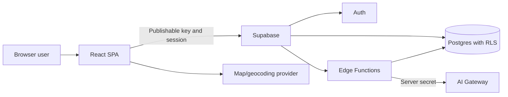

# 🛡️ Threat Model

## System boundary

BizRadar runs in a browser and communicates with Supabase Auth/Postgres/Edge Functions, a configured map/geocoding provider, and a model gateway called from trusted functions.

## Assets
- User identities and sessions.
- Saved business ideas and report records.
- AI conversation history/context.
- Database schema and RLS policies.
- Server-side AI gateway credential.
- Provider quotas and cost budgets.
- User-entered business concepts and contact fields.
- Integrity/provenance of analytics outputs.

## Trust boundaries
1. Browser input/state.
2. Public Supabase configuration.
3. Authenticated session.
4. Postgres RLS boundary.
5. Edge Function request boundary.
6. Server-side secrets/model provider.
7. External map/geocoding provider.

## Threat scenarios

| Threat | Weakness to examine | Mitigation |
|---|---|---|
| Secret exposure | Tracked env or Vite-prefixed server key | Rotate, ignore, secret scan |
| Cross-user leak | Weak/missing RLS | Two-user policy tests |
| Cost abuse | Unauthenticated parser | Quotas, rate limits and payload caps |
| Prompt injection | User text/context passed to model | Treat as data; validate outputs |
| Malformed model output | Blind JSON parsing | Schema validation |
| CORS misuse | Wildcard origins | Origin allowlist |
| Session misuse | Invalid/stale tokens | Server-side auth validation |
| Data over-retention | Long conversation histories | Limits and deletion policy |
| False analytics | Synthetic values appear factual | Provenance labels |
| Map quota abuse | Unrestricted public token | Domain and quota restrictions |

## Controls observed
- Browser client uses publishable key.
- AuthContext subscribes to auth changes and calls getSession.
- ai-assistant calls auth.getUser().
- JWT verification is enabled for ai-assistant and generate-insights in config.
- SQL migrations and generated types exist.

These do not prove remote RLS or deployment settings are correct.

## Residual risk
High until tracked .env cleanup, function validation/abuse controls, RLS verification and consistent output handling are completed. Treat business ideas and conversation content as user-sensitive information.
