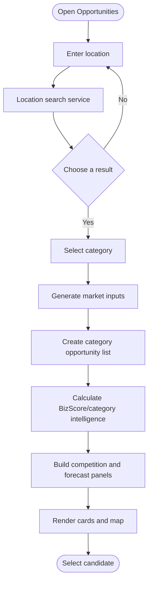
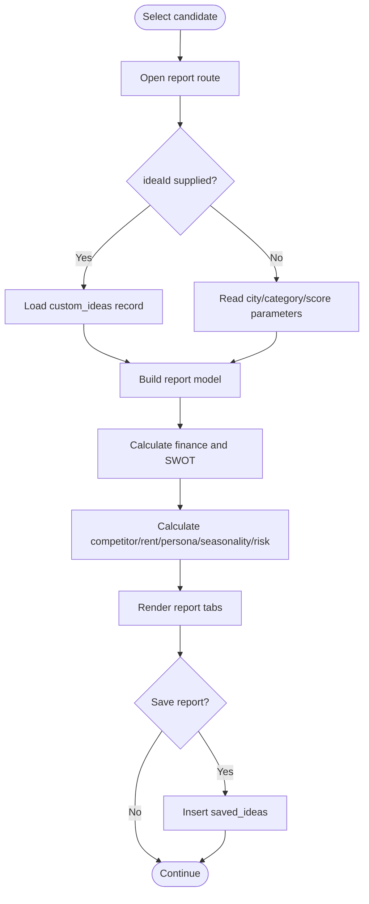
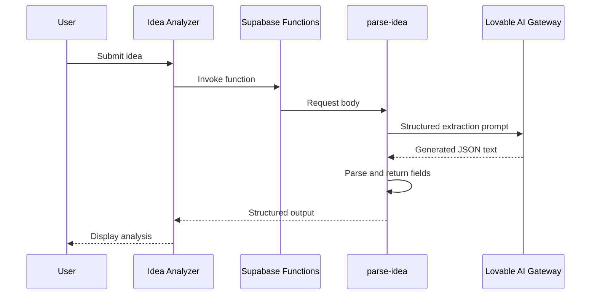
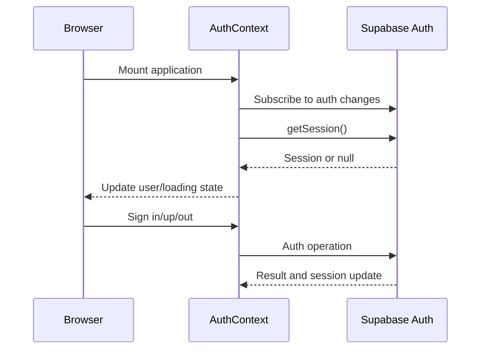

# 🔁 Product Workflows

## 1. Opportunity exploration

## 2. Feasibility report

## 3. AI idea parsing

## 4. Authentication

## 5. Save ownership

Saved rows should be bound to the authenticated user's ID. Database RLS must enforce ownership. Client-side filters and hidden routes are not security boundaries.
